# Synthetic Threat Pipeline

A one-command Docker cyber range that generates **labelled** attack and normal security
events, builds an ML dataset from them, trains an attack detector, and flags attacks
live on a dashboard.

The bots that generate the traffic also write the **ground truth**, so every event's
label comes from a time-and-IP join against what a bot actually did — not from matching
strings in the log. Events no bot claims stay *unlabelled*; they are never silently
called "normal".

---

## What v2 fixes

| v1 | v2 |
|----|----|
| Labels from string-matching the logs (circular: the model learns the matcher) | Labels from a **ground-truth join** on `src_ip` + time window written by the bots |
| 100% malicious data + synthetic "normal" injected to fake a baseline | Benign **and** attack bots generate real traffic side by side |
| One Random Forest, no baseline to beat | **Baselines** (hand-written rules + the old 3-feature RF) that every model must clear |
| No held-out evaluation | **Time-ordered** split + time-series CV (never tested on the past) |
| Detection by keyword matching | A trained model served over an API, scoring live windows |

---

## Architecture

```mermaid
flowchart LR
  subgraph range["Honeypot range (profile: range)"]
    C[Cowrie SSH :2222]
    F[VSFTPD FTP :21]
    D[DVWA web :8080]
    S[sar2html :80]
    V[Flask victim :5000]
  end
  B[Bots: attackers + benign<br/>+ ground-truth labels] -->|traffic| range
  range -->|logs| L[(Loki / log files)]
  L --> P[Parsers → common event schema]
  B -->|labels.csv| J
  P --> J[Label join<br/>src_ip + time window]
  J --> FE[Feature builder<br/>1/5/15-min windows]
  FE --> DS[(features.parquet + data card)]
  DS --> T[Train: baselines + models<br/>time-split, CV, model card]
  T --> M[(model.joblib)]
  M --> API[Scorer API<br/>/health /model /score /alerts]
  L --> W[Loki worker] --> API
  API --> UI[Dashboard alerts panel]
```



---

## Quick start

### Prerequisites
- Docker & Docker Compose (WSL2 backend on Windows)
- Python 3.11+
- 16 GB RAM recommended if you run the Wazuh SOC profile (8 GB for the range alone)

### 1. Configure
```bash
cp .env.example .env        # set passwords; never commit .env
pip install -r requirements.txt
```

### 2. Boot the range
```bash
docker compose --profile range up -d      # honeypots only
# docker compose --profile range --profile soc --profile ui up -d   # + Wazuh SIEM + log stack
```
Admin ports bind to `127.0.0.1` only. The honeypot network blocks egress.

### 3. Generate labelled traffic
```bash
python -m bots.scheduler --hours 8 --seed 1 --attack-ratio 0.5    # overnight run
python -m bots.scheduler --dry-run                               # preview the plan, no traffic
python -m bots attackers.ssh_brute --bot-id demo-1 --duration 60 # run one bot
```

### 4. Build the dataset, train, serve
```bash
make dataset     # parse logs → join labels → features.parquet + data_card.json
make train       # baselines + models → model.joblib + model_card.json
make test        # full suite
uvicorn pipeline.api:app --port 8000      # scoring API
python -m controller.brain                 # Loki worker: tails logs, scores live
cd frontend-simple && npm install && npm run dev   # dashboard
```

---

## The data contract

Every parser emits the **same event schema** (`pipeline/parsers/base.py`):

| field | meaning |
|-------|---------|
| `ts` | UTC ISO-8601 timestamp |
| `source` | cowrie / vsftpd / apache / flask |
| `service` | ssh / ftp / http |
| `src_ip`, `dst_port` | attacker IP, target port |
| `event` | login_fail, login_ok, command, download, request, upload … |
| `username`, `status_code`, `payload` | truncated to 4 KB |
| `label`, `attack_type`, `bot_id` | **null until the join fills them** |

Bots write one label row per run: `bot_id,label,attack_type,t_start,t_end,src_ip`.
The join claims every event matching the IP within `[t_start, t_end]`; an attack row
wins over a normal one on overlap.

**Features** (`pipeline/features.py`) are per-IP over 1/5/15-minute tumbling windows:
volume, failed-login and HTTP-error ratios, inter-arrival timing and burstiness,
payload signals (SQL keywords, `../`, shell metacharacters, encoding) and breadth.
The IP value itself and raw event/status codes are **excluded** — they leak the label.

---

## Machine learning

`make train` (`pipeline/train.py`):
- **Baselines**: a hand-written rules detector and the old 3-feature Random Forest.
- **Models**: Logistic Regression, Random Forest, Gradient Boosting.
- **Split**: oldest windows train, most recent 30% test; expanding-window time-series CV.
- **Pick**: best test F1, tie-broken on recall (a missed attack costs more).
- **Explainability**: permutation importance (SHAP if installed).
- **Output**: `model.joblib` + `model_card.json` recording metrics, label balance and whether each model beat the baselines.

Before any attack labels exist it ships an unsupervised IsolationForest and says so,
instead of pretending to have trained a detector.

---

## Live scoring

`pipeline/api.py` (FastAPI):

| endpoint | purpose |
|----------|---------|
| `GET /health` | liveness + whether a model is loaded |
| `GET /model` | the model card |
| `POST /score` | `{"events": [...]}` → per-window alerts (prediction, score, severity) |
| `GET /alerts` | recent flagged windows, newest first |

`controller/brain.py` tails Loki, runs lines through the **same parsers** the dataset
uses, and scores via the model. `frontend-simple` polls `/alerts` and renders flagged
IPs with severity.

---

## Testing & CI

```bash
make lint    # ruff on bots, pipeline, controller
make test    # pytest
```
GitHub Actions (`.github/workflows/ci.yml`) runs ruff + pytest and a gitleaks
working-tree secret scan on every push and PR.

---

## Security

- No secrets in the repo; passwords come from `.env` (gitignored). CI scans for leaks.
- Admin ports bound to localhost; honeypot egress blocked.
- Hash or truncate `src_ip` before exporting any dataset outside the range.
- Rotate any credential that ever touched a committed file.

---

## Repo layout

```
bots/            attacker + benign traffic generators, scheduler, shared runtime
pipeline/        parsers, label join, feature builder, dataset, train, scorer, API
controller/      Loki tail worker (live scoring)
frontend-simple/ React dashboard (world map, live feed, model alerts)
Dockerfiles/     honeypot images;  docker-compose.yml  one file, profiles range/soc/ui
Makefile         dataset · train · test · lint
```

## Status

The Python pipeline (parsers → join → features → train → score) is tested end-to-end on
real logs. A **live run and the overnight bot generation need Docker running**; the
scorer's own compose service and a full-stack smoke test are wired once Docker is up.
